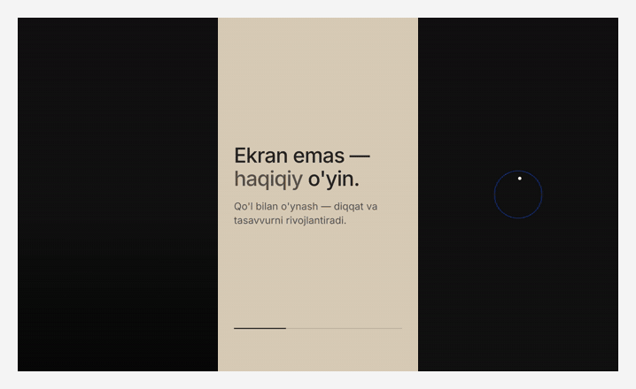
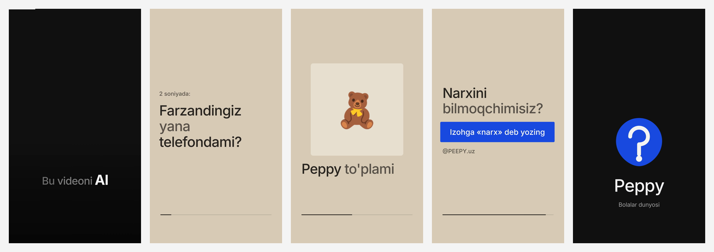

<div align="center">

# Akmal AI Toolkit

**AI bilan media yaratish — brifdan tayyor videogacha.**
*Open-source AI media studio for creators and small businesses — Uzbek-first.*

[](LICENSE)
[](skills/)
[](prompts/)
[](scripts/master-audio.sh)
[](https://abdulazizyursinaliyev-source.github.io/akmal-ai-toolkit/)



[**Jonli demo**](https://abdulazizyursinaliyev-source.github.io/akmal-ai-toolkit/) · [Skill'lar](#-claude-skilllari) · [Promptlar](#-promptlar) · [Tezkor boshlash](#-tezkor-boshlash) · [English](#english)

</div>

---

## Nima bu?

Bitta repo — bitta to'liq **AI media pipeline**: hook, skript, multfilm personaj, logo, rasm, ovoz, musiqa, SFX, **−14 LUFS** mastering, animatsion subtitr, GSAP/CSS animatsiya, HTML → MP4 render va deploy.

Hammasi uch qatlamda:

| Qatlam | Nima | Kimga |
|---|---|---|
| 🧠 **Skill'lar** | Claude uchun `SKILL.md` — butun ish jarayonini o'zi boshqaradi | Claude Code / Cowork foydalanuvchilari |
| ✍️ **Promptlar** | Nusxa ol → `[...]` ni to'ldir → modelga ber | Har qanday AI (Gemini, ChatGPT, Veo, Suno, ElevenLabs) |
| ⚙️ **Kod** | Ishlaydigan skriptlar va shablonlar — sinovdan o'tgan | Natijani avtomatlashtirmoqchilar |



## 🔄 Pipeline

```
 BRIF ─► HOOK ─► SKRIPT ─► SHOTLIST ─► VIZUAL (Veo · rasm · personaj)
                                              │
 DEPLOY ◄─ RENDER ◄─ SUBTITR ◄─ MASTER −14 LUFS ◄─ OVOZ + MUSIQA + SFX
```

## 🧠 Claude skill'lari

| Skill | Vazifa |
|---|---|
| [`media-director`](skills/media-director/SKILL.md) | **Bosh rejissyor** — brifdan tayyor videogacha 10 bosqichni boshqaradi |
| [`story-hook-character`](skills/story-hook-character/SKILL.md) | 2 soniyalik hook, 6 bitli hikoya, izchil multfilm personaj |
| [`audio-post`](skills/audio-post/SKILL.md) | Voice-over, musiqa, SFX cue sheet, ducking, −14 LUFS |
| [`motion-subtitles`](skills/motion-subtitles/SKILL.md) | Whisper so'z vaqtlari → GSAP yoki `.ass` → videoga |
| [`brand-design`](skills/brand-design/SKILL.md) | Logo, dizayn tokenlari, poster, carousel, end card |
| [`web-motion-deploy`](skills/web-motion-deploy/SKILL.md) | GSAP/CSS animatsiya tamoyillari, render, GitHub Pages |

**O'rnatish (Claude Code):**
```bash
git clone https://github.com/abdulazizyursinaliyev-source/akmal-ai-toolkit
cp -r akmal-ai-toolkit/skills/* ~/.claude/skills/
```
Keyin Claude'ga oddiy yozing: *"Peppy uchun 15 soniyalik reklama video tayyorla"* — `media-director` ishga tushadi.

## ✍️ Promptlar

| Fayl | Nima uchun |
|---|---|
| [`hook-library.md`](prompts/hook-library.md) | 12 turdagi hook, o'zbekcha shablonlar, vizual promptlar |
| [`ad-script.md`](prompts/ad-script.md) | H-P-S-P-C tuzilma, 15/30/60s, so'z soni, Claude prompti |
| [`video-veo-prompt.md`](prompts/video-veo-prompt.md) | Veo 3.1 / Gemini formulasi, timestamp usuli, negative prompt |
| [`character-cartoon.md`](prompts/character-cartoon.md) | Personaj pasporti, character sheet, izchillik (reference lock) |
| [`image-design.md`](prompts/image-design.md) | Rasm formulasi, professional lug'at, mahsulot shablonlari |
| [`logo-brand.md`](prompts/logo-brand.md) | Logo brifi, generatsiya, vektorlash, tekshiruv |
| [`poster-prompt.md`](prompts/poster-prompt.md) | Uzum / WB / Ozon kartochka — JSON shablon |
| [`voiceover.md`](prompts/voiceover.md) | O'zbekcha VO: skript qoidalari, ovoz brifi, sozlamalar |
| [`music-sfx.md`](prompts/music-sfx.md) | Suno prompt, janr/BPM jadvali, SFX lug'ati, miks darajalari |

## ⚙️ Kod — sinovdan o'tgan

| Fayl | Nima qiladi |
|---|---|
| [`scripts/master-audio.sh`](scripts/master-audio.sh) | Ovoz tozalash + musiqa ducking + SFX → **ikki bosqichli loudnorm −14 LUFS / −1 dBTP** |
| [`scripts/render-html.js`](scripts/render-html.js) | GSAP/CSS sahifani **kadrma-kadr** MP4 yoki shaffof ProRes'ga render |
| [`scripts/srt-to-ass.py`](scripts/srt-to-ass.py) | `.srt` → Reels uslubidagi karaoke `.ass` |
| [`scripts/assemble-video.sh`](scripts/assemble-video.sh) | Klip'lar → 9:16 + crossfade + audio + subtitr → MP4 |
| [`templates/motion-subtitles.html`](templates/motion-subtitles.html) | So'zma-so'z subtitr, 4 uslub |
| [`templates/ad-scenes.html`](templates/ad-scenes.html) | 15 soniyalik kinetik reklama (5 sahna) |
| [`templates/logo-reveal.html`](templates/logo-reveal.html) | SVG logo chizilishi → to'lishi → nom |
| [`templates/css-animations.css`](templates/css-animations.css) | 20+ JS'siz animatsiya, scroll-driven, reduced-motion |
| [`templates/brand-tokens.css`](templates/brand-tokens.css) | Dizayn tizimi tokenlari |

## 🚀 Tezkor boshlash

```bash
git clone https://github.com/abdulazizyursinaliyev-source/akmal-ai-toolkit
cd akmal-ai-toolkit
npm i playwright gsap && npx playwright install chromium   # bir marta

# 1. Kinetik reklama → MP4 (1080×1920)
node scripts/render-html.js templates/ad-scenes.html ad.mp4

# 2. Ovoz + musiqa + SFX → -14 LUFS
bash scripts/master-audio.sh -v voice.wav -m music.mp3 -s sfx.wav -o final.wav
# ✅ Tayyor: -14.00 LUFS, true peak -2.88 dBTP

# 3. Subtitr + yig'ish
python3 scripts/srt-to-ass.py voice.srt subs.ass
bash scripts/assemble-video.sh -a final.wav -s subs.ass -o reel.mp4 clip1.mp4 clip2.mp4 clip3.mp4
```

Talablar: `ffmpeg`, `node 18+`, `python 3.9+`.

## 🎨 Dizayn tizimi

Barcha grafika [**Taste Skill**](https://github.com/Leonxlnx/taste-skill) (MIT) tokenlariga asoslangan:

| | | |
|---|---|---|
|  |  |  |
|  |  |  |

Bitta aksent · kontrast bilan ajratish · sentence case · radius 8/12/20.

## 📂 Tuzilma

```
akmal-ai-toolkit/
├── skills/        6 ta Claude skill (SKILL.md)
├── prompts/       9 ta prompt kutubxonasi
├── templates/     GSAP/CSS shablonlar + dizayn tokenlari
├── scripts/       audio, render, subtitr, yig'ish
├── automation/    Instagram DM bot skriptlari
├── content/       Instagram o'sish rejasi
├── news/          AI yangiliklar logi
├── docs/          preview rasmlar
└── index.html     jonli demo sayt (GitHub Pages)
```

## 🗺 Yo'l xaritasi

- [x] 6 skill · 9 prompt kutubxonasi · 4 shablon · 4 skript
- [x] HTML → MP4 render (kadrma-kadr, shaffof fon)
- [x] −14 LUFS ikki bosqichli mastering
- [ ] O'zbekcha TTS ovozlar taqqoslovi
- [ ] `examples/` — har prompt uchun haqiqiy oldin/keyin natijalar
- [ ] To'liq inglizcha tarjima

## 🤝 Hissa qo'shish

Yangi prompt, shablon yoki tuzatish — [CONTRIBUTING.md](CONTRIBUTING.md). Foydali bo'lsa — **⭐ yulduzcha bosing**, bu loyihani ko'proq odamga yetkazadi.

---

## English

**Akmal AI Toolkit** is an open-source, Uzbek-first AI media production kit: **6 Claude skills**, **9 prompt libraries**, and **tested code** covering the full pipeline — hooks, ad scripts, consistent cartoon characters, logos, image prompts, voice-over, music & SFX, **two-pass −14 LUFS mastering** (ffmpeg), word-by-word **motion subtitles**, **GSAP/CSS animation templates**, a **frame-accurate HTML → MP4 renderer** (Playwright), and GitHub Pages deploy.

```bash
node scripts/render-html.js templates/ad-scenes.html ad.mp4          # HTML → MP4
bash scripts/master-audio.sh -v voice.wav -m music.mp3 -o final.wav     # → −14 LUFS
```

Prompts are written in English (models understand them best); explanations are in Uzbek. MIT licensed.

---

<div align="center">
Muallif: <b>Akmal</b> — tadbirkor (Frutata, Peppy), AI'ni kichik biznesda amaliy qo'llash.<br>
<a href="https://github.com/abdulazizyursinaliyev-source/akmal-ai-toolkit/issues">Savol yoki taklif</a>
</div>
